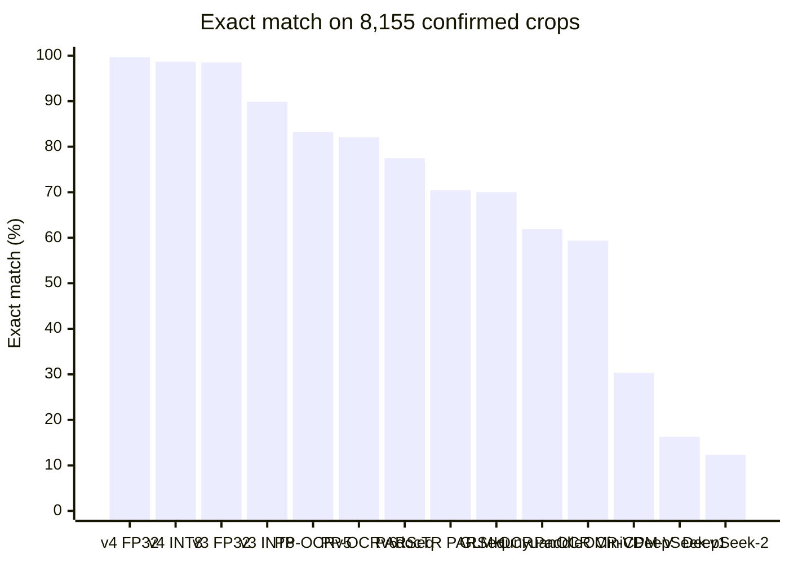

# Meter Serial-Number OCR

   

Reads the **serial number** printed on electricity-meter nameplates from cropped photos of the serial area. A **fine-tuned PaddleOCR PP-OCRv5 recognizer**, quantized to a **21.4 MB INT8 ONNX model**, runs on CPU without Paddle and attaches a confidence score to every read, so that only uncertain reads go to a person.

## Key figures

| | **v3 INT8** (in production) | **v4 INT8** (release candidate) |
|---|---|---|
| Exact match, TPDDL July 2026 (6,153 crops, never trained on) | 92.52% | **97.82%** |
| Precision of auto-accepted reads (same set) | 95.69% | **98.21%** |
| Share of reads auto-accepted (same set) | 92.3% | **97.3%** |
| Exact match, held-out `test_old` (1,024 crops, 74% with letters) | 87.21% | **90.04%** |
| FP32 → INT8 agreement (2,704 crops) | 93.3% | **98.6%** |
| Model size (FP32 ONNX: 84.1 MB) | 21.4 MB | 21.4 MB |
| CPU time per crop, 1 thread (FP32: 253 ms) | 18 ms | 18 ms |

INT8 quantization makes the model **3.9× smaller and 14× faster** than FP32.

On the 8,155 confirmed crops, the best of 28 off-the-shelf OCR and vision models (no fine-tuning) reads 83.24% exactly, against 98.66% for v4 INT8; on the 948 crops whose labels are not our models' shared read, it is 84.39% against 88.50% ([comparison](#our-models-vs-off-the-shelf-ocr-and-vision-models-7-nov-2026)).

  →  

```
input : a 232×50 crop of a meter nameplate
output: ('<serial number>', 0.98, 'accepted')
```

## How it works

1. **Preprocess:** resize the crop to height 48 keeping its aspect ratio, pad to 48×320, normalize.
2. **Recognize:** PP-OCRv5 SVTR recognizer (HGNet backbone, CTC head), exported to ONNX and quantized to INT8.
3. **Decode:** greedy CTC decoding; the confidence is the mean probability of the decoded characters.
4. **Gate:** every read gets one of three outcomes:
   - `accepted`: confidence ≥ 0.95, used without a human check;
   - `review`: confidence below 0.95, sent to a person;
   - `blank`: nothing could be read.

The repository covers **recognition only**: the input is already a crop of the serial region, so no text detector is used.

## Accuracy of all models

Exact match against the label (upper-case, spaces ignored), measured with the production pipeline (`deploy/ptq_int8/meterocr.py`) on CPU.

| Model | `test_old` (1,024) | `test_new` (1,680) | `test_new_hard` (171) | TPDDL July 2026 (6,153) |
|---|---|---|---|---|
| v3 FP32 | 91.02% | 93.39% | 35.09% | 99.19% |
| **v3 INT8** (production) | 87.21% | 91.01% | 11.70% | 92.52% |
| v4 FP32 | 90.82% | **98.99%** | **91.81%** | 97.85% |
| **v4 INT8** (candidate) | 90.04% | 98.81% | 90.64% | 97.82% |

**Precision of auto-accepted reads** (share of reads with confidence ≥ 0.95 that are correct):

| Model | `test_old` | `test_new` | TPDDL July 2026 |
|---|---|---|---|
| v3 FP32 | 93.92% | 94.65% | 99.42% |
| **v3 INT8** (production) | 93.48% | 93.55% | 95.69% |
| v4 FP32 | 93.06% | 99.10% | 98.14% |
| **v4 INT8** (candidate) | 92.38% | 98.91% | 98.21% |

**About the test sets**
- **`test_old`:** v3's held-out split, and the most neutral comparison between v3 and v4.
- **`test_new`:** v4's held-out split. It comes from the same source as v4's new training data.
- **`test_new_hard`:** the part of `test_new` that v3 had misread, re-labelled by people. v3's low score there is by construction.
- **TPDDL July 2026:** a different utility that neither model was trained on. Its labels were kept only where several models agreed, so the set leans towards easier crops.
- **Stock PP-OCRv5:** the starting model (`models/base/`) scored 85.20% on 196 held-out crops in July 2026, against 87.76% after the first fine-tune. It was not scored on the sets above.

Sources: `results/2026-11-02_v4/` (first three sets, timing) and the deploy-pipeline run of 5 Nov 2026 (TPDDL July).

### Field validation of the production model (v3)

21,042 sharp crops on which the utility's previous OCR had failed (`datasets/test/clean_test_oct27/`):

| Scoring | v3 FP32 | v3 INT8 (production) |
|---|---|---|
| Exact match vs department serial (21,042) | 83.0% | 79.6% |
| After human review, readable crops only (18,105) | 93.33% | 91.04% |
| Precision of auto-accepted reads after review | 94.29% | 93.49% |

People reviewed all 4,744 reads that either model got wrong:
- 1,771 department serials were confirmed and 36 were corrected;
- 2,937 crops (62%) could not be read by people either.

Most of the remaining errors are therefore photos that cannot be read, not model mistakes.

### Check on 8,155 confirmed crops (7 Nov 2026)

All four models read 8,155 crops from the 5 Nov 2026 capture without seeing any label (`scripts/step1_run_all_models.py`); the reads were then scored against the serials confirmed during review (`scripts/step2_check_accuracy.py`). This set is used for testing only: no model was trained on it, and none of these crops are in v3's or v4's training data.

| Model | Right | Exact match | Auto-accepted (≥ 0.95) but wrong |
|---|---|---|---|
| v3 FP32 | 8,033 | 98.50% | 96 |
| **v3 INT8** (production) | 7,322 | 89.79% | 424 |
| v4 FP32 | 8,127 | **99.66%** | **18** |
| **v4 INT8** (candidate) | 8,046 | 98.66% | 77 |

**Word and character errors** (same reads; a serial is one word, character error = edits ÷ 65,116 label characters):

| Model | Word error | Character error | Wrong char | Extra char | Missing char | Off by one char |
|---|---|---|---|---|---|---|
| v3 FP32 | 1.50% | 0.20% | 98 | 8 | 23 | 115 of 122 |
| **v3 INT8** (production) | 10.21% | 1.44% | 663 | 182 | 91 | 753 of 833 |
| v4 FP32 | **0.34%** | **0.05%** | 30 | 0 | 0 | 26 of 28 |
| **v4 INT8** (candidate) | 1.34% | 0.17% | 97 | 6 | 8 | 107 of 109 |

- Per crop, v4 INT8 reads 796 crops right that v3 INT8 gets wrong; the reverse happens on 72.
- Almost every error is a single character; v3 INT8 also adds characters (182 against 6 for v4 INT8).
- The INT8 model gives the same read as its FP32 model on 98.8% of crops for v4, against 90.0% for v3.
- **Not an unbiased accuracy figure.** For 7,207 of the 8,155 crops the label is the serial all four models read alike, so every model scores 100% on them. All differences come from the other 948 crops (exact match v3 FP32 87.13%, v3 INT8 12.13%, v4 FP32 97.05%, v4 INT8 88.50%; character error 1.69% / 12.25% / 0.39% / 1.45%), and most of their labels were also set where the FP32 or v4 models agreed. Use this check to compare the models; the held-out sets above give the fair accuracy.

Source: `results/2026-11-07_confirmed_8155/` (`model_reads.xlsx`, `accuracy_report.xlsx`).

### Our models vs off-the-shelf OCR and vision models (7 Nov 2026)

The same 8,155 confirmed crops were also read by 28 public OCR, scene-text and vision-language models, used as released with no fine-tuning. Every read, including those of our four models, was scored against the same labels after upper-casing and keeping only A–Z and 0–9, because the off-the-shelf models often add punctuation or spaces.



The first four bars are our fine-tuned models; the others are a selection of the off-the-shelf models (all 28 are in the full table below).

| Model | Type | Exact match, all 8,155 | Exact match, other 948 | Character error |
|---|---|---|---|---|
| v4 FP32 | Fine-tuned PP-OCRv5 (this project) | **99.66%** | **97.05%** | **0.05%** |
| **v4 INT8** (candidate) | Fine-tuned PP-OCRv5 (this project) | 98.66% | 88.50% | 0.17% |
| v3 FP32 | Fine-tuned PP-OCRv5 (this project) | 98.50% | 87.13% | 0.20% |
| **v3 INT8** (production) | Fine-tuned PP-OCRv5 (this project) | 89.88% | 12.97% | 1.42% |
| PP-OCRv5 server rec, A–Z/0–9 decoding | PP-OCR recognizer | 83.24% | 82.91% | 2.32% |
| PP-OCRv6 medium rec, A–Z/0–9 decoding | PP-OCR recognizer | 82.08% | 84.39% | 2.43% |
| PARSeq base | Scene-text recognizer | 77.46% | 82.59% | 3.21% |
| docTR PARSeq | Scene-text recognizer (docTR) | 70.42% | 67.93% | 4.81% |
| GLM-OCR 0.9B | OCR vision-language model | 70.02% | 70.89% | 4.63% |
| HunyuanOCR 1.5 (1B) | OCR vision-language model | 61.89% | 56.33% | 7.14% |
| PaddleOCR-VL 1.6 (0.9B) | OCR vision-language model | 59.36% | 53.16% | 7.90% |
| MiniCPM-V 8B | General vision-language model | 30.37% | 22.15% | 22.24% |
| DeepSeek-OCR v1 (3B) | OCR vision-language model | 16.31% | 11.50% | 84.35% |
| DeepSeek-OCR-2 | OCR vision-language model | 12.34% | 8.76% | 108.24% |

- **Fine-tuning matters most.** The best off-the-shelf model reads 83.24% of crops exactly; v4 FP32 reads 99.66% and v4 INT8 98.66%.
- **On the fairer 948 crops** (see below), v4 FP32 scores 97.05% and v4 INT8 88.50%, against 84.39% for the best off-the-shelf model.
- **v3 INT8 is weak on those 948 crops** (12.97%, against 88.50% for v4 INT8), which agrees with the held-out results that made v4 INT8 the release candidate.

<details>
<summary>All 32 models (click to expand)</summary>

| # | Model | Type | Right | Exact match, all 8,155 | Agreed 7,207 | Other 948 | Character error | GPU time per crop (ms) |
|---|---|---|---|---|---|---|---|---|
| 1 | v4 FP32 | Fine-tuned (this project) | 8,127 | 99.66% | 100.00% | 97.05% | 0.05% | – |
| 2 | **v4 INT8** (candidate) | Fine-tuned (this project) | 8,046 | 98.66% | 100.00% | 88.50% | 0.17% | – |
| 3 | v3 FP32 | Fine-tuned (this project) | 8,033 | 98.50% | 100.00% | 87.13% | 0.20% | – |
| 4 | **v3 INT8** (production) | Fine-tuned (this project) | 7,330 | 89.88% | 100.00% | 12.97% | 1.42% | – |
| 5 | PP-OCRv5 server rec, A–Z/0–9 decoding | PP-OCR recognizer | 6,788 | 83.24% | 83.28% | 82.91% | 2.32% | 0.74 |
| 6 | PP-OCRv5 server rec | PP-OCR recognizer | 6,783 | 83.18% | 83.22% | 82.81% | 2.33% | 0.84 |
| 7 | RapidOCR PP-OCRv5 server rec (ONNX, CPU) | PP-OCR recognizer | 6,773 | 83.05% | 83.06% | 83.02% | 2.34% | 29.98 (CPU) |
| 8 | PP-OCRv6 medium rec, A–Z/0–9 decoding | PP-OCR recognizer | 6,694 | 82.08% | 81.78% | 84.39% | 2.43% | 0.95 |
| 9 | PP-OCRv6 medium rec | PP-OCR recognizer | 6,671 | 81.80% | 81.49% | 84.18% | 2.47% | 1.04 |
| 10 | PARSeq base | Scene-text recognizer | 6,317 | 77.46% | 76.79% | 82.59% | 3.21% | 0.62 |
| 11 | docTR PARSeq | Scene-text recognizer (docTR) | 5,743 | 70.42% | 70.75% | 67.93% | 4.81% | 0.72 |
| 12 | GLM-OCR 0.9B | OCR vision-language model | 5,710 | 70.02% | 69.90% | 70.89% | 4.63% | 46.12 |
| 13 | docTR CRNN VGG16-BN | Scene-text recognizer (docTR) | 5,628 | 69.01% | 69.74% | 63.50% | 4.75% | 0.42 |
| 14 | docTR ViTSTR-small | Scene-text recognizer (docTR) | 5,426 | 66.54% | 67.12% | 62.13% | 5.97% | 0.57 |
| 15 | docTR ViTSTR-base | Scene-text recognizer (docTR) | 5,308 | 65.09% | 65.34% | 63.19% | 6.59% | 1.32 |
| 16 | MGP-STR base | Scene-text recognizer | 5,072 | 62.19% | 61.11% | 70.46% | 6.90% | 5.99 |
| 17 | TrOCR base printed | Scene-text recognizer | 5,062 | 62.07% | 63.04% | 54.75% | 6.76% | 12.66 |
| 18 | HunyuanOCR 1.5 (1B) | OCR vision-language model | 5,047 | 61.89% | 62.62% | 56.33% | 7.14% | 52.40 |
| 19 | docTR CRNN MobileNetV3-large | Scene-text recognizer (docTR) | 4,974 | 60.99% | 62.15% | 52.22% | 7.17% | 0.33 |
| 20 | PaddleOCR-VL 1.6 (0.9B) | OCR vision-language model | 4,841 | 59.36% | 60.18% | 53.16% | 7.90% | 17.07 |
| 21 | PaddleOCR-VL 1.5 (0.9B) | OCR vision-language model | 4,837 | 59.31% | 59.96% | 54.43% | 8.07% | 15.91 |
| 22 | docTR VIPTR-tiny | Scene-text recognizer (docTR) | 4,833 | 59.26% | 60.51% | 49.79% | 6.92% | 0.48 |
| 23 | docTR MASTER | Scene-text recognizer (docTR) | 4,827 | 59.19% | 59.91% | 53.69% | 9.08% | 1.57 |
| 24 | docTR CRNN MobileNetV3-small | Scene-text recognizer (docTR) | 4,493 | 55.10% | 56.10% | 47.47% | 8.80% | 0.32 |
| 25 | docTR SAR ResNet31 | Scene-text recognizer (docTR) | 2,635 | 32.31% | 32.84% | 28.27% | 27.16% | 1.13 |
| 26 | MiniCPM-V 8B | General vision-language model | 2,477 | 30.37% | 31.46% | 22.15% | 22.24% | 350.88 |
| 27 | DeepSeek-OCR v1 (3B) | OCR vision-language model | 1,330 | 16.31% | 16.94% | 11.50% | 84.35% | 522.84 |
| 28 | Qwen3-VL 2B | General vision-language model | 1,269 | 15.56% | 15.85% | 13.40% | 47.16% | 883.56 |
| 29 | Qwen2.5-VL 3B | General vision-language model | 1,234 | 15.13% | 15.48% | 12.45% | 48.78% | 1,106.94 |
| 30 | Qwen2.5-VL 7B | General vision-language model | 1,186 | 14.54% | 14.87% | 12.03% | 54.72% | 1,417.96 |
| 31 | EasyOCR english_g2 | Scene-text recognizer | 1,109 | 13.60% | 14.01% | 10.44% | 36.71% | 3.76 |
| 32 | DeepSeek-OCR-2 | OCR vision-language model | 1,006 | 12.34% | 12.81% | 8.76% | 108.24% | 108.35 |

Ranked by exact match on all 8,155 crops. GPU time is the mean per crop in the benchmark run on an RTX 5080; the RapidOCR row ran on CPU.

</details>

<details>
<summary>How to read these numbers</summary>

- **Scoring rule.** Labels and reads are upper-cased and reduced to A–Z and 0–9 before comparison. Our models are scored the same way, so v3 INT8 shows 7,330 right (89.88%) here against 7,322 (89.79%), 12.97% against 12.13% on the other 948 crops, and character error 1.42% against 1.44% in the check above, which only ignores spaces; v3 FP32, v4 FP32 and v4 INT8 are unchanged.
- **"A–Z/0–9 decoding"** means the model's output was limited to letters and digits at decoding time; its weights are unchanged.
- **Label bias.** For 7,207 crops ("agreed") the label is the serial all four of our models read alike, so our models score 100% there by construction. The off-the-shelf models score about the same on the 7,207 and on the other 948 crops, so they are not flattered by this bias. The 948 crops are the fairer comparison for our models, though still favourable to them, because most of their labels were also set where our FP32 or v4 models agreed.
- **Hard crops.** At least one of the 28 off-the-shelf models reads 8,045 crops (98.65%) correctly; 110 crops are read by none of them. Of those 110, v4 FP32 reads 108, v3 FP32 107, v4 INT8 107 and v3 INT8 99; their labels mostly come from our models' reads, so this is expected and is not independent evidence.
- **Vision-language models** such as DeepSeek-OCR are built for full document pages. On a small serial crop they often return formulas, tables or extra text, so their character error can exceed 100% (more edits than label characters).
- **Character error** = total edit distance ÷ 65,116 label characters.
- **Speed is not comparable across rows.** Off-the-shelf times were measured on an RTX 5080 GPU; our models run on CPU (18 ms per crop for INT8, 253 ms for FP32, one thread).
- Benchmark run on 7 Nov 2026. Model versions and sources are in the `model_id` column of `results/2026-11-07_confirmed_8155/off_the_shelf_comparison.csv`.

</details>

## Model versions

| Version | Started from | Training data | Status |
|---|---|---|---|
| v1 | stock PP-OCRv5 | 1,144 labels | replaced |
| v2 | stock PP-OCRv5 | 6,709 labels | replaced |
| **v3** | stock PP-OCRv5 | 6,733 labels (`datasets/v3_train`) | **in production (INT8)** |
| **v4** | v3 FP32 | 23,707 labels (`datasets/v4_train`) | **release candidate (INT8)** |

**v4 training**
- **Data:** v3's 6,733 labels plus 16,974 new crops:
  - 1,807 human-reviewed crops that v3 had misread;
  - 15,167 crops where the department serial, EasyOCR, v3 FP32 and v3 INT8 all agreed with confidence ≥ 0.95.

  New crops were split 80/10/10 by capture session.
- **Recipe** (`training/train_v4.py`): 20 epochs, batch 128, learning rate 4e-5, one RTX 5080, 22 minutes. Best validation accuracy was 96.23%, at epoch 16.

## Quantization

The post-training INT8 recipe used for v3 and v4 (`quantization/quantize_v4_ptq.py`):

1. **Export** the training weights with **Paddle 3.0.0** (PIR v1). Paddle 3.3.1 exports PIR v4, which `paddle2onnx 2.1.0` cannot read.
2. **Convert and fold:** `paddle2onnx` to ONNX FP32, then fold constants with `quant_pre_process`. This also removes the unused NRTR head (205 → 84 MB).
3. **Quantize** with `quantize_static`:
   - QDQ format with **per-tensor** scaling on Conv/MatMul/Gemm;
   - 200 calibration crops drawn at random across capture sessions.

   Per-channel scaling truncated long serials, so it is not used.

## Deployment

- **Production model:** v3 INT8 in `deploy/ptq_int8/`: the model, the character dictionary and `meterocr.py` (preprocessing, CTC decoding and the 0.95 gate). It needs only ONNX Runtime.
- **Server package** (built from `deploy/ptq_int8/`, kept outside this repository), for Python 3.8 with onnxruntime 1.16.3:
  - Flask API on port 8080 with `GET /health`, `POST /ocr` and `POST /ocr/batch`;
  - a Dockerfile whose `HEALTHCHECK` polls `/health` every 30 s;
  - a systemd unit with `Restart=always`;
  - a Python client and a smoke test;
  - step-by-step instructions in `DEPLOY.md`.
- **Switching to v4:** replace the model file with `models/v4/meterocr_v4_int8_ptq.onnx`. Input, output, dictionary and gate are identical.

## Quick start

```bash
# production model (ONNX Runtime only)
cd deploy/ptq_int8 && pip install -r requirements.txt
python3 -c "from meterocr import MeterOCR; print(MeterOCR().predict('crop.jpg'))"
# -> ('<serial number>', 0.98, 'accepted')

# v4 with the same code
python3 -c "from meterocr import MeterOCR; print(MeterOCR(model_path='../../models/v4/meterocr_v4_int8_ptq.onnx').predict('crop.jpg'))"

# a whole folder on all CPU cores -> CSV
.venv/bin/python scripts/run_ptq_folder.py --images <crops_dir> --out reads.csv --model v4
```

## Training and quantization

```bash
python3 training/train_v4.py             # v4 training (refuses to overwrite models/v4)
python3 quantization/quantize_v4_ptq.py  # v4 export, INT8 quantization and scoring
```

Both scripts switch to the right Python environment themselves. The GPU training environment (Paddle 3.3.1, CUDA 13), the Paddle 3.0.0 export environment and the PaddleOCR repository live outside this repository; see `PROJECT_SUMMARY.md`.

## Repository layout

```
.
├── README.md · PROJECT_SUMMARY.md
├── datasets/       training data per version and test sets, each images/ + labels.csv (README inside)
├── models/         base/ · v3/ · v4/: FP32 Paddle, FP32 ONNX, INT8 ONNX, training weights (README inside)
├── deploy/         ptq_int8/: production model, dictionary and inference code
├── training/       train_v4.py · rec_v3.yml · rec_v4.yml · logs/
├── quantization/   quantize_v3_ptq.py · quantize_v4_ptq.py (export → ONNX → INT8 → scoring)
├── results/        2026-10-27_v3_clean_test/ · 2026-11-02_v4/ · 2026-11-04_all_models_test/ · 2026-11-05_review_21425/ · 2026-11-07_confirmed_8155/
├── scripts/        inference, batch scoring and data-preparation scripts
└── assets/         README images
```

Datasets and model binaries are not in the repository because of their size; the production INT8 model in `deploy/ptq_int8/` is. `datasets/README.md` records which version used which data and where every label came from.

## Next steps

- Decide whether to deploy v4 INT8, after reviewing its 74 confidently wrong reads on `test_old`.
- Score v4 on the remaining independent sets: `datasets/test/tpddl/` (3,460) and `datasets/test/tpcodl_human_verified/` (712).
