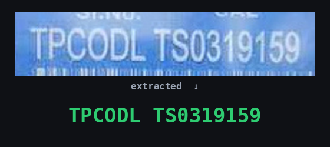

# Meter Serial-Number OCR

   

Reads the **serial number** printed on electricity-meter nameplates from cropped photos of the serial area. A **fine-tuned PaddleOCR PP-OCRv5 recognizer**, quantized to a **21.4 MB INT8 ONNX model**, runs on CPU without Paddle and attaches a confidence score to every read, so that only uncertain reads go to a person.

## Key figures

| | **v3 INT8** (in production) | **v4 INT8** (release candidate) |
|---|---|---|
| Exact match, TPDDL July 2026 (6,153 crops, never trained on) | 92.52% | **97.82%** |
| Precision of auto-accepted reads (same set) | 95.69% | **98.21%** |
| Share of reads auto-accepted (same set) | 92.3% | **97.3%** |
| Exact match, held-out `test_old` (1,024 crops, 74% with letters) | 87.21% | **90.04%** |
| FP32 → INT8 agreement (2,704 crops) | 93.3% | **98.6%** |
| Model size (FP32 ONNX: 84.1 MB) | 21.4 MB | 21.4 MB |
| CPU time per crop, 1 thread (FP32: 253 ms) | 18 ms | 18 ms |

INT8 quantization makes the model **3.9× smaller and 14× faster** than FP32.

  →  

```
input : a 232×50 crop of a meter nameplate
output: ('<serial number>', 0.98, 'accepted')
```

## How it works

1. **Preprocess:** resize the crop to height 48 keeping its aspect ratio, pad to 48×320, normalize.
2. **Recognize:** PP-OCRv5 SVTR recognizer (HGNet backbone, CTC head), exported to ONNX and quantized to INT8.
3. **Decode:** greedy CTC decoding; the confidence is the mean probability of the decoded characters.
4. **Gate:** every read gets one of three outcomes:
   - `accepted`: confidence ≥ 0.95, used without a human check;
   - `review`: confidence below 0.95, sent to a person;
   - `blank`: nothing could be read.

The repository covers **recognition only**: the input is already a crop of the serial region, so no text detector is used.

## Accuracy of all models

Exact match against the label (upper-case, spaces ignored), measured with the production pipeline (`deploy/ptq_int8/meterocr.py`) on CPU.

| Model | `test_old` (1,024) | `test_new` (1,680) | `test_new_hard` (171) | TPDDL July 2026 (6,153) |
|---|---|---|---|---|
| v3 FP32 | 91.02% | 93.39% | 35.09% | 99.19% |
| **v3 INT8** (production) | 87.21% | 91.01% | 11.70% | 92.52% |
| v4 FP32 | 90.82% | **98.99%** | **91.81%** | 97.85% |
| **v4 INT8** (candidate) | 90.04% | 98.81% | 90.64% | 97.82% |

**Precision of auto-accepted reads** (share of reads with confidence ≥ 0.95 that are correct):

| Model | `test_old` | `test_new` | TPDDL July 2026 |
|---|---|---|---|
| v3 FP32 | 93.92% | 94.65% | 99.42% |
| **v3 INT8** (production) | 93.48% | 93.55% | 95.69% |
| v4 FP32 | 93.06% | 99.10% | 98.14% |
| **v4 INT8** (candidate) | 92.38% | 98.91% | 98.21% |

**About the test sets**
- **`test_old`:** v3's held-out split, and the most neutral comparison between v3 and v4.
- **`test_new`:** v4's held-out split. It comes from the same source as v4's new training data.
- **`test_new_hard`:** the part of `test_new` that v3 had misread, re-labelled by people. v3's low score there is by construction.
- **TPDDL July 2026:** a different utility that neither model was trained on. Its labels were kept only where several models agreed, so the set leans towards easier crops.
- **Stock PP-OCRv5:** the starting model (`models/base/`) scored 85.20% on 196 held-out crops in July 2026, against 87.76% after the first fine-tune. It was not scored on the sets above.

Sources: `results/2026-11-02_v4/` (first three sets, timing) and the deploy-pipeline run of 5 Nov 2026 (TPDDL July).

### Field validation of the production model (v3)

21,042 sharp crops on which the utility's previous OCR had failed (`datasets/test/clean_test_oct27/`):

| Scoring | v3 FP32 | v3 INT8 (production) |
|---|---|---|
| Exact match vs department serial (21,042) | 83.0% | 79.6% |
| After human review, readable crops only (18,105) | 93.33% | 91.04% |
| Precision of auto-accepted reads after review | 94.29% | 93.49% |

People reviewed all 4,744 reads that either model got wrong:
- 1,771 department serials were confirmed and 36 were corrected;
- 2,937 crops (62%) could not be read by people either.

Most of the remaining errors are therefore photos that cannot be read, not model mistakes.

## Model versions

| Version | Started from | Training data | Status |
|---|---|---|---|
| v1 | stock PP-OCRv5 | 1,144 labels | replaced |
| v2 | stock PP-OCRv5 | 6,709 labels | replaced |
| **v3** | stock PP-OCRv5 | 6,733 labels (`datasets/v3_train`) | **in production (INT8)** |
| **v4** | v3 FP32 | 23,707 labels (`datasets/v4_train`) | **release candidate (INT8)** |

**v4 training**
- **Data:** v3's 6,733 labels plus 16,974 new crops:
  - 1,807 human-reviewed crops that v3 had misread;
  - 15,167 crops where the department serial, EasyOCR, v3 FP32 and v3 INT8 all agreed with confidence ≥ 0.95.

  New crops were split 80/10/10 by capture session.
- **Recipe** (`training/train_v4.py`): 20 epochs, batch 128, learning rate 4e-5, one RTX 5080, 22 minutes. Best validation accuracy was 96.23%, at epoch 16.

## Quantization

The post-training INT8 recipe used for v3 and v4 (`quantization/quantize_v4_ptq.py`):

1. **Export** the training weights with **Paddle 3.0.0** (PIR v1). Paddle 3.3.1 exports PIR v4, which `paddle2onnx 2.1.0` cannot read.
2. **Convert and fold:** `paddle2onnx` to ONNX FP32, then fold constants with `quant_pre_process`. This also removes the unused NRTR head (205 → 84 MB).
3. **Quantize** with `quantize_static`:
   - QDQ format with **per-tensor** scaling on Conv/MatMul/Gemm;
   - 200 calibration crops drawn at random across capture sessions.

   Per-channel scaling truncated long serials, so it is not used.

## Deployment

- **Production model:** v3 INT8 in `deploy/ptq_int8/`: the model, the character dictionary and `meterocr.py` (preprocessing, CTC decoding and the 0.95 gate). It needs only ONNX Runtime.
- **Server package** (built from `deploy/ptq_int8/`, kept outside this repository), for Python 3.8 with onnxruntime 1.16.3:
  - Flask API on port 8080 with `GET /health`, `POST /ocr` and `POST /ocr/batch`;
  - a Dockerfile whose `HEALTHCHECK` polls `/health` every 30 s;
  - a systemd unit with `Restart=always`;
  - a Python client and a smoke test;
  - step-by-step instructions in `DEPLOY.md`.
- **Switching to v4:** replace the model file with `models/v4/meterocr_v4_int8_ptq.onnx`. Input, output, dictionary and gate are identical.

## Quick start

```bash
# production model (ONNX Runtime only)
cd deploy/ptq_int8 && pip install -r requirements.txt
python3 -c "from meterocr import MeterOCR; print(MeterOCR().predict('crop.jpg'))"
# -> ('<serial number>', 0.98, 'accepted')

# v4 with the same code
python3 -c "from meterocr import MeterOCR; print(MeterOCR(model_path='../../models/v4/meterocr_v4_int8_ptq.onnx').predict('crop.jpg'))"

# a whole folder on all CPU cores -> CSV
.venv/bin/python scripts/run_ptq_folder.py --images <crops_dir> --out reads.csv --model v4
```

## Training and quantization

```bash
python3 training/train_v4.py             # v4 training (refuses to overwrite models/v4)
python3 quantization/quantize_v4_ptq.py  # v4 export, INT8 quantization and scoring
```

Both scripts switch to the right Python environment themselves. The GPU training environment (Paddle 3.3.1, CUDA 13), the Paddle 3.0.0 export environment and the PaddleOCR repository live outside this repository; see `PROJECT_SUMMARY.md`.

## Repository layout

```
.
├── README.md · PROJECT_SUMMARY.md
├── datasets/       training data per version and test sets, each images/ + labels.csv (README inside)
├── models/         base/ · v3/ · v4/: FP32 Paddle, FP32 ONNX, INT8 ONNX, training weights (README inside)
├── deploy/         ptq_int8/: production model, dictionary and inference code
├── training/       train_v4.py · rec_v3.yml · rec_v4.yml · logs/
├── quantization/   quantize_v3_ptq.py · quantize_v4_ptq.py (export → ONNX → INT8 → scoring)
├── results/        2026-10-27_v3_clean_test/ · 2026-11-02_v4/ · 2026-11-04_all_models_test/ · 2026-11-05_review_21425/
├── scripts/        inference, batch scoring and data-preparation scripts
└── assets/         README images
```

Datasets and model binaries are not in the repository because of their size; the production INT8 model in `deploy/ptq_int8/` is. `datasets/README.md` records which version used which data and where every label came from.

## Next steps

- Decide whether to deploy v4 INT8, after reviewing its 74 confidently wrong reads on `test_old`.
- Score v4 on the remaining independent sets: `datasets/test/tpddl/` (3,460) and `datasets/test/tpcodl_human_verified/` (712).
